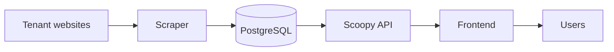

# Scoopy

<div align="center">


**Price tracking platform for product monitoring and history analysis**

Scoopy collects product prices from multiple tenants, stores the historical data in the database, and exposes it through an API that can be consumed by the frontend.

</div>

---

## Overview

Scoopy is split into three main parts:

- [Frontend](frontend/README.md) for the user interface and data visualization.
- [Scoopy API](scoopy-api/README.md) for the Rails backend that exposes product and price history data.
- [Scraper](scraper/README.md) for the Playwright-based automation that collects tenant prices and stores them in PostgreSQL.

Each part has its own README with the detailed setup, structure, and behavior of that subproject.

## Docker and Cloudflare Tunnel

The root `docker-compose.yml` runs the API, frontend, scraper and verifier.
PostgreSQL and Cloudflare Tunnel are external services; the tunnel must already
be running and connected to the external Docker network named by
`TUNNEL_NETWORK_NAME`. Configure the tunnel's public hostnames to route to
`http://frontend:80` and `http://api:3000`, respectively. Neither application
service needs a published host port for that arrangement.

The Compose services use Linux `amd64` images, matching the API's locked
platform and the deployment configuration. An `x86_64` Linux server runs these
natively; an ARM server needs working `amd64` emulation and is not the native
deployment target. Install Docker Engine and a Compose plugin that supports
`include` (Compose 2.20 or newer); the host also needs outbound access to build
images and to reach provider websites.

Copy `example.env` to `.env` and configure the database, Rails secrets,
`TUNNEL_NETWORK_NAME`, `VITE_API_URL` (the public HTTPS API URL), and
`CORS_ALLOWED_ORIGINS` (including the public HTTPS frontend origin). The
frontend URL is compiled into the image, so rebuild it when `VITE_API_URL`
changes. After confirming the external network and tunnel routes:

```bash
docker compose up -d --build
docker compose ps
docker compose logs api scraper
```

The API entrypoint runs `db:prepare` and `solid_queue:prepare` before Puma
starts. The scraper waits for the API health check, so a first batch cannot
run before those preparations finish. If migration fails, the API does not
become healthy and the scraper does not start. Stop any **previously running**
scraper before upgrading the database, back up the database, and deploy the
API and scraper together; startup ordering cannot stop an old container that
is already running. See [product model migration](docs/product-model-design.md)
for the irreversible migration and legacy data behavior.
The verifier initializes the shared screenshot volume for the API's
unprivileged UID/GID 1000 so Rails can read and remove expired screenshots.
Keep that volume writable by the verifier during initialization.

On Linux, `localhost` inside a container is not the host. For PostgreSQL
running on the Docker host, use `PGHOST=host.docker.internal`: the Compose
configuration maps that name to Docker's host gateway. PostgreSQL must listen
on an address reachable from the Docker bridge networks, and its `pg_hba.conf`
and the host firewall must allow the API and scraper connections. Restrict
access to the required Docker networks; do not expose PostgreSQL publicly.
If PostgreSQL is another container, put it and both clients on a shared Docker
network and set `PGHOST` to its service name instead. The tunnel network must
be a user-defined network shared with the `cloudflared` container so Docker DNS
can resolve `api` and `frontend`.

## What Scoopy Does

At a high level, Scoopy works like this:

1. The scraper reads product identifiers from the database and visits each tenant site.
2. The scraper extracts the current price and stores it in the historical price tables.
3. The API serves the stored products and price history to clients.
4. The frontend presents that information in a user-friendly interface.

The goal is to centralize price monitoring so the project can track changes over time and make the data easy to inspect.

## Project Structure

```text
Scoopy/
├── assets/
├── frontend/
├── scraper/
├── scoopy-api/
└── README.md
```

## Architecture



## Documentation

For the implementation details of each part, see:

- [Add Product Wizard](docs/add-product-feature.md)
- [Admin Features](docs/admin-feature.md)
- [Frontend README](frontend/README.md)
- [Scoopy API README](scoopy-api/README.md)
- [Scraper README](scraper/README.md)
